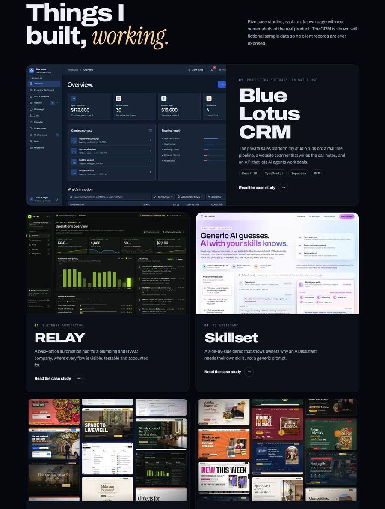

# Joshua Sajor · Portfolio

**Live:** [joshua-sajor-portfolio.vercel.app](https://joshua-sajor-portfolio.vercel.app)



My personal portfolio. It has five case studies of things I've built:

- a production CRM;
- a business automation hub;
- an AI assistant demo;
- a ten-site demo gallery;
- website studios for real local businesses.

It's hand-written HTML, CSS and JavaScript, with no framework and no template.

## Highlights

- **Multi-page static site from one layout.** A ~100-line Node script (`scripts/build-pages.mjs`) builds every page from a shared layout and partials. It also writes:
  - page titles and canonical URLs;
  - the active nav state;
  - the "next case study" pager and the sitemap;
  - a content hash that cache-busts the CSS and JS.
- **No runtime dependencies.** One stylesheet and an 8 KB script. The script handles:
  - accessible tabs with arrow-key support;
  - hover-to-scroll page previews;
  - a statement that lights up as you read;
  - a live Manila clock;
  - copy-to-clipboard with a screen-reader announcement.
- **Accessible:**
  - a skip link;
  - one `h1` per page;
  - `aria-current` navigation;
  - visible focus rings;
  - a keyboard-operable menu and tabs;
  - `prefers-reduced-motion` support.
- **Fast:**
  - responsive WebP images with `srcset`;
  - a preloaded hero;
  - lazy loading for everything below the fold;
  - long cache headers for images.
- **Safe screenshots of a real product.** The CRM is in daily use, so it can't be shown with its real data. Its screenshots are taken from the live UI, and every database request is intercepted and answered with fictional data (`scripts/crm-mock.mjs`). No client record is ever shown.
- **A real photo.** The portrait is my own photo, cut out with a background-removal model and relit with `sharp`. AI image generation was used only for background scenery.

## Structure

```
src/
  layout.html          page shell: head, nav, main, footer slots
  partials/            nav, contact section, CTA band + footer
  pages/               one file per page
scripts/
  build-pages.mjs      src/  ->  site/*.html + sitemap.xml
  serve.mjs            local server that mirrors Vercel's clean URLs and 404 page
  build-images.mjs     responsive WebP variants
  portrait.mjs         portrait cutout, rim light and grade
  crm-mock.mjs         CRM screenshots with fictional data
site/                  the deployed static site
screenshots/           desktop and phone captures
```

## Run locally

```bash
node scripts/build-pages.mjs
node scripts/serve.mjs 5190
```

Then open http://localhost:5190.

- **Pages:** edit them in `src/`. The `site/*.html` files are generated.
- **Styles and script:** `site/styles.css` and `site/main.js` are edited directly.
- **Image scripts:** they need `sharp`, and the raw source photos are not in this repo.

## Stack

HTML · CSS · vanilla JavaScript · Node.js build scripts · sharp · Puppeteer · Vercel

## Contact

[joshuasajor28@gmail.com](mailto:joshuasajor28@gmail.com) · [Blue Lotus Coding](https://bluelotuscoding.com) · [Demo gallery](https://demo.bluelotuscoding.com)

---

Code and design © 2026 Joshua Sajor. Shared so you can see how it's built. Please don't republish the design, copy or photos as your own.
